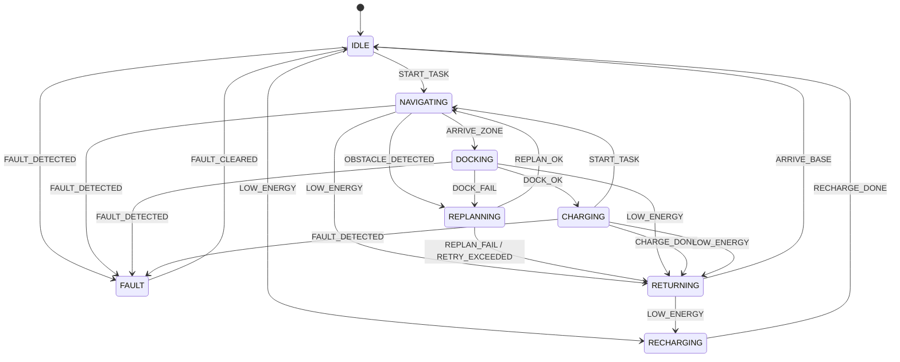
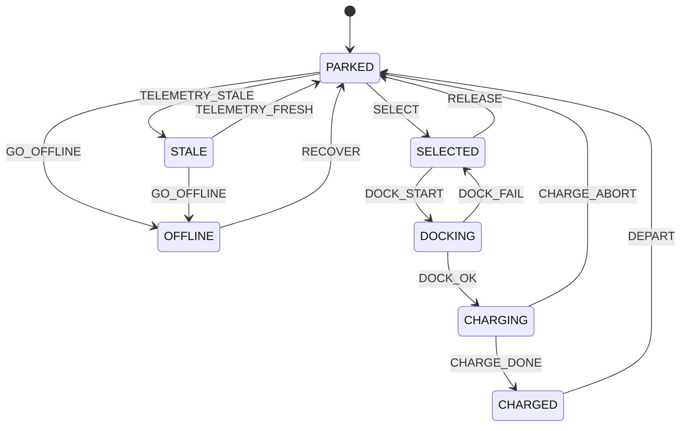
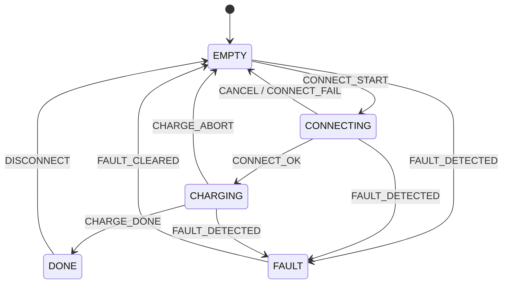

# 状态机契约

- **契约版本**：`v1.0.0`（与 `api.md` / `telemetry.json` 同步）
- **状态**：FROZEN（冻结，变更走 `api.md` 第 8 节流程）
- **契约 Owner**：Kimi（系统负责人）
- **适用范围**：校园共享电动车移动集群充电**仿真**系统（所有状态迁移均为仿真数据，非真实车辆数据）

> 本文定义三套相互独立又彼此联动的状态机：**机器人状态机**、**车辆状态机**、**充电通道状态机**。状态枚举为固定集合，任何实现不得增删、改名；触发事件使用大写下划线命名，跨线统一。

---

## 0. 全局约定与事件词典

### 0.1 约定

1. 状态枚举固定，大小写敏感；遥测中的 `status` 字段取值必须与本文一致。
2. 迁移是**原子**的：一次事件只触发一次状态改变，并产生一条 `TaskEvent` 事件日志。
3. 三套状态机通过同一任务 `batch_id` / `vehicle_id` 联动（见第 4 节）。
4. 所有时间以**后端仿真时钟**为准（见 `api.md` 第 2 节），时间戳为 UTC ISO 8601。

### 0.2 事件词典（跨线统一）

| 事件 | 含义 | 主要触发方 |
|---|---|---|
| `START_TASK` | 调度器派发新任务 | 后端调度器 |
| `ARRIVE_ZONE` | 机器人到达目标停车区对接位姿 | 机器人线 / MockRobot |
| `DOCK_OK` | 自动对接成功 | 机器人线 + 后端对接抽象 |
| `DOCK_FAIL` | 自动对接失败（超误差/接口不可用） | 机器人线 + 后端对接抽象 |
| `CHARGE_DONE` | 车辆达到目标 SOC，充电完成 | 后端能源模型 |
| `LOW_ENERGY` | 机器人余能低于返基站阈值 | 后端能源模型 |
| `ARRIVE_BASE` | 机器人到达基站 | 机器人线 / MockRobot |
| `RECHARGE_DONE` | 机器人在基站补能完成 | 后端能源模型 |
| `OBSTACLE_DETECTED` | 检测到临时障碍 | `POST /api/demo/obstacle` / 机器人线 |
| `REPLAN_OK` | 重规划成功 | 机器人线 |
| `REPLAN_FAIL` / `RETRY_EXCEEDED` | 重规划失败 / 对接重试超上限 | 机器人线 |
| `FAULT_DETECTED` / `FAULT_CLEARED` | 故障发生 / 故障解除 | 任一线 |
| `SELECT` / `RELEASE` | 车辆被选中 / 取消选中 | 后端调度器 |
| `DOCK_START` | 车辆进入对接流程 | 后端调度器 |
| `TELEMETRY_STALE` / `TELEMETRY_FRESH` | 车辆遥测过期 / 恢复 | 车辆线（种子化模拟） |
| `GO_OFFLINE` / `RECOVER` | 车辆离线 / 恢复在线 | 车辆线（种子化模拟） |
| `CHARGE_ABORT` | 充电中止 | 后端调度器 |
| `DEPART` | 车辆离位（车位释放） | 后端调度器 |
| `CONNECT_START` / `CONNECT_OK` / `CANCEL` | 通道连接开始 / 成功 / 取消 | 后端充电管理 |
| `DISCONNECT` | 通道断开，释放通道 | 后端充电管理 |

---

## 1. 机器人状态机

### 1.1 状态枚举（固定）

`IDLE`、`NAVIGATING`、`REPLANNING`、`DOCKING`、`CHARGING`、`RETURNING`、`RECHARGING`、`FAULT`

### 1.2 状态图

### 1.3 合法迁移表

| # | 源状态 | 触发事件 | 目标状态 | 说明 |
|---|---|---|---|---|
| R1 | `IDLE` | `START_TASK` | `NAVIGATING` | 收到派单，从基站出发前往目标区 |
| R2 | `IDLE` | `LOW_ENERGY` | `RECHARGING` | 待机时余能不足，先在基站补能 |
| R3 | `IDLE` | `FAULT_DETECTED` | `FAULT` | 待机时检测到故障 |
| R4 | `NAVIGATING` | `ARRIVE_ZONE` | `DOCKING` | 到达目标车辆对接位姿 |
| R5 | `NAVIGATING` | `OBSTACLE_DETECTED` | `REPLANNING` | 临时障碍触发重规划 |
| R6 | `NAVIGATING` | `LOW_ENERGY` | `RETURNING` | 途中余能不足，提前返基站 |
| R7 | `NAVIGATING` | `FAULT_DETECTED` | `FAULT` | 导航中故障 |
| R8 | `REPLANNING` | `REPLAN_OK` | `NAVIGATING` | 重规划成功，恢复导航 |
| R9 | `REPLANNING` | `REPLAN_FAIL` / `RETRY_EXCEEDED` | `RETURNING` | 重规划失败或对接重试超限，返基站 |
| R10 | `DOCKING` | `DOCK_OK` | `CHARGING` | 对接成功，开始充电 |
| R11 | `DOCKING` | `DOCK_FAIL` | `REPLANNING` | 对接失败，重新规划/重试 |
| R12 | `DOCKING` | `LOW_ENERGY` | `RETURNING` | 对接阶段余能不足 |
| R13 | `DOCKING` | `FAULT_DETECTED` | `FAULT` | 对接阶段故障 |
| R14 | `CHARGING` | `CHARGE_DONE` | `RETURNING` | 本批任务完成，离开充电位返基站 |
| R15 | `CHARGING` | `START_TASK` | `NAVIGATING` | 同批次仍有待充车辆，直接前往下一辆 |
| R16 | `CHARGING` | `LOW_ENERGY` | `RETURNING` | 充电中余能不足，提前返基站 |
| R17 | `CHARGING` | `FAULT_DETECTED` | `FAULT` | 充电中故障 |
| R18 | `RETURNING` | `ARRIVE_BASE` | `IDLE` | 到达基站，待命 |
| R19 | `RETURNING` | `LOW_ENERGY` | `RECHARGING` | 余能过低，到达基站后直接补能 |
| R20 | `RECHARGING` | `RECHARGE_DONE` | `IDLE` | 补能完成，恢复待命 |
| R21 | 任意上述状态 | `FAULT_CLEARED` | `IDLE`（从 `FAULT`） | 故障解除，回到待命 |

### 1.4 实现约束

- 对接重试上限与位姿误差阈值见 `simulation_params.md`；超限时走 R9，不得在 `DOCKING` 无限循环。
- `LOW_ENERGY` 优先级高于 `START_TASK`：余能不足时严禁派发新任务。
- `FAULT` 为异常态，只能经 `FAULT_CLEARED` 迁移到 `IDLE`。

---

## 2. 车辆状态机

### 2.1 状态枚举（固定）

`PARKED`、`SELECTED`、`DOCKING`、`CHARGING`、`CHARGED`、`STALE`、`OFFLINE`

### 2.2 状态图

### 2.3 合法迁移表

| # | 源状态 | 触发事件 | 目标状态 | 说明 |
|---|---|---|---|---|
| V1 | `PARKED` | `SELECT` | `SELECTED` | 被调度器选中，纳入当前批次 |
| V2 | `PARKED` | `TELEMETRY_STALE` | `STALE` | 遥测超过陈旧阈值，暂不可调度 |
| V3 | `PARKED` | `GO_OFFLINE` | `OFFLINE` | 种子化模拟车辆离线 |
| V4 | `STALE` | `TELEMETRY_FRESH` | `PARKED` | 收到新遥测，恢复可调度 |
| V5 | `STALE` | `GO_OFFLINE` | `OFFLINE` | 陈旧车辆转为离线 |
| V6 | `OFFLINE` | `RECOVER` | `PARKED` | 车辆恢复在线 |
| V7 | `SELECTED` | `RELEASE` | `PARKED` | 取消选中（补位/重排） |
| V8 | `SELECTED` | `DOCK_START` | `DOCKING` | 机器人到达，开始对接 |
| V9 | `DOCKING` | `DOCK_OK` | `CHARGING` | 对接成功，开始充电 |
| V10 | `DOCKING` | `DOCK_FAIL` | `SELECTED` | 对接失败，等待重试 |
| V11 | `CHARGING` | `CHARGE_DONE` | `CHARGED` | 达到目标 SOC 80% |
| V12 | `CHARGING` | `CHARGE_ABORT` | `PARKED` | 充电中止，回到普通停放 |
| V13 | `CHARGED` | `DEPART` | `PARKED` | 车辆离位，车位释放 |

### 2.4 实现约束

- 仅 `PARKED` 状态的车辆可被 `SELECT`；`STALE` / `OFFLINE` / 其他状态车辆不得纳入调度。
- `stale` 遥测标志为 `true` 时车辆状态应为 `STALE`（或由 `STALE` 恢复），两者必须一致，否则视为契约违规。
- 车辆 SOC 达到目标值（默认 80%）时由 `CHARGING` → `CHARGED`，并产生 `CHARGE_DONE` 事件。

---

## 3. 充电通道状态机

### 3.1 状态枚举（固定）

`EMPTY`、`CONNECTING`、`CHARGING`、`DONE`、`FAULT`

### 3.2 状态图

### 3.3 合法迁移表

| # | 源状态 | 触发事件 | 目标状态 | 说明 |
|---|---|---|---|---|
| C1 | `EMPTY` | `CONNECT_START` | `CONNECTING` | 车辆对接成功，通道开始连接 |
| C2 | `EMPTY` | `FAULT_DETECTED` | `FAULT` | 通道自检故障 |
| C3 | `CONNECTING` | `CONNECT_OK` | `CHARGING` | 连接建立，开始充电 |
| C4 | `CONNECTING` | `CANCEL` / `CONNECT_FAIL` | `EMPTY` | 连接取消/失败，释放通道 |
| C5 | `CONNECTING` | `FAULT_DETECTED` | `FAULT` | 连接阶段故障 |
| C6 | `CHARGING` | `CHARGE_DONE` | `DONE` | 充电完成，等待断开 |
| C7 | `CHARGING` | `CHARGE_ABORT` | `EMPTY` | 充电中止，释放通道 |
| C8 | `CHARGING` | `FAULT_DETECTED` | `FAULT` | 充电中通道故障 |
| C9 | `DONE` | `DISCONNECT` | `EMPTY` | 断开连接，通道恢复空闲 |
| C10 | `FAULT` | `FAULT_CLEARED` | `EMPTY` | 故障解除，通道恢复空闲 |

### 3.4 实现约束

- 系统共 **5 路**充电通道，每路独立跑本状态机，互不影响。
- 通道状态为 `EMPTY` 才可被新任务占用；五路全非 `EMPTY` 时派发应返回 `5003 CHANNEL_UNAVAILABLE`。
- 充电功率与传输损耗见 `simulation_params.md`，通道状态机不重复定义能源参数。

---

## 4. 三机联动一致性规则（强制）

> 一次完整充电任务中，三套状态机必须按以下时序联动。任一环节不一致，WS 推送视为契约违规。

| 阶段 | 机器人 | 车辆 | 充电通道 | 触发事件 |
|---|---|---|---|---|
| 1 派单 | `IDLE → NAVIGATING` | `PARKED → SELECTED` | `EMPTY → CONNECTING`（预占） | `START_TASK` / `SELECT` |
| 2 到达 | `NAVIGATING → DOCKING` | `SELECTED → DOCKING` | 保持 `CONNECTING` | `ARRIVE_ZONE` / `DOCK_START` |
| 3 对接 | `DOCKING → CHARGING` | `DOCKING → CHARGING` | `CONNECTING → CHARGING` | `DOCK_OK` / `CONNECT_OK` |
| 4 完成 | `CHARGING → RETURNING` | `CHARGING → CHARGED` | `CHARGING → DONE` | `CHARGE_DONE` |
| 5 释放 | `RETURNING → IDLE` | `CHARGED → PARKED` | `DONE → EMPTY` | `ARRIVE_BASE` / `DEPART` / `DISCONNECT` |
| 异常 | `→ RETURNING` | `SELECTED → PARKED` | `→ EMPTY` | `DOCK_FAIL` / `RETRY_EXCEEDED` |

补充规则：

1. `DOCK_OK` 在机器人侧与车辆侧必须**同时**成立；单侧成功不算成功。
2. `CHARGE_DONE` 必须同时驱动车辆 `CHARGED`、通道 `DONE`、机器人离开（`RETURNING` 或下一任务 `NAVIGATING`）。
3. 对接失败重试超限（见 `simulation_params.md`）时：机器人走 R9 → `RETURNING`，车辆走 V7 → `PARKED`，通道走 C4 → `EMPTY`，并记 `DOCK_FAIL` 事件。
4. `LOW_ENERGY` 触发返基站时，当前未完成任务应释放车辆与通道，避免资源悬挂。

---

## 5. 版本变更记录

| 版本 | 日期 | 说明 |
|---|---|---|
| `v1.0.0` | 2026-11-18 | 首版冻结：三套状态机（机器人 8 态 / 车辆 7 态 / 通道 5 态）+ 合法迁移表 + 跨机联动规则；状态枚举与 `telemetry.json`、`api.md` 对齐。 |
