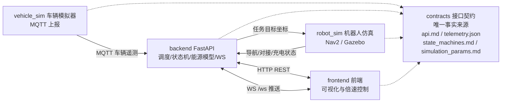

# 校园共享电动车移动集群充电仿真系统 — 系统架构说明

> 对应 `docs/project_scope.md` 的 P0 冻结边界；所有组件均为**仿真**，非真实部署。
> `contracts/` 是唯一接口事实来源，三条开发线通过契约解耦。

---

## 1. 总体架构图

组件职责：

- **车辆模拟器 `vehicle_sim/`**：按 `scenarios/campus_basic.yaml` 生成 30 辆车的仿真遥测（id/zone/slot/x/y/soc/status/online），经 MQTT 上报；不控制车辆行驶。
- **后端 `backend/`（FastAPI）**：接入遥测、过滤 offline/stale、按冻结权重打分选车（每批 ≤5）、维护机器人状态机与能源模型、驱动仿真时钟、通过 WebSocket 推送统一视图。
- **机器人仿真 `robot_sim/`（Nav2 / Gazebo）**：接收目标坐标，完成导航、避障、对接、五路充电、返基站；提供与 MockRobot 等价的接口。
- **前端 `frontend/`**：订阅 WS，展示车辆/机器人/任务/事件，提供倍速（1/10/60）控制，并显式标注"仿真"。
- **契约 `contracts/`**：`api.md`、`telemetry.json`、`state_machines.md`、`simulation_params.md`，解耦各线。

---

## 2. 数据流向说明

1. **上报流**：`vehicle_sim` --MQTT--> 后端接入层 --> 状态过滤（剔除 offline / stale）--> 调度打分池。
2. **调度流**：打分池（low_soc 0.35 / avg_soc 0.20 / distance 0.25 / robot_energy 0.20）--> 每批选 ≤5 辆 --> 生成充电任务。
3. **执行流**：后端下发目标坐标 --> 机器人 NAVIGATING --> DOCKING --> CHARGING（5 路 × 3.5 kW，损耗 0.05，效率 0.95）--> 离开 --> RETURNING / RECHARGING。
4. **推送流**：后端按仿真时钟 tick 将 RobotTelemetry / VehicleTelemetry / TaskEvent 经 `WS /ws` 推送前端；前端展示，且状态与 `GET /api/robot`、`GET /api/vehicles`、`GET /api/tasks`、`GET /api/events` 一致。
5. **控制流**：前端通过 REST 调用 `/api/simulation/start|pause|resume|reset|speed` 控制后端时钟（倍速 1/10/60，ISO8601 UTC）。
6. **闭环性**：从启动到"下一批 / 返基站"全程无人工确认；所有对外数据带 `simulation: true`。

---

## 3. 为什么三轨并行 + P5 汇合（接口冻结的价值）

- **并行前提**：后端、机器人、前端三条线彼此不依赖对方的实现，只依赖 P1 冻结的 `contracts/`。接口（端点、 telemetry schema、状态机、参数）先行冻结后，三线可同时开工，互不等待，显著缩短课程周期。
- **接口冻结即"事实来源"**：`contracts/` + `scenarios/campus_basic.yaml` 固定了参数基线（机器人 5.0 kWh / 100% / 0.05 kWh 每 100 m / 效率 0.95；30 辆 A12/B10/C8 目标 80%；5 路 × 3.5 kW 损耗 0.05；权重 0.35/0.20/0.25/0.20；每批 ≤5；后端时钟倍速 1/10/60）。三线按同一组数字实现，避免"各写各的"导致联调对不上。
- **P5 汇合**：P1~P4 各线在契约边界内独立自测（后端用 MockRobot 闭环、机器人跑通状态机、前端对接 mock 数据），到 P5 才做端到端汇合。此时若接口无歧义，汇合成本最低；一旦发现问题，也只需回归契约而非重写三线业务代码。
- **变更受控**：任何参数/接口变更先改 `contracts/` 与本文档，再同步三线，杜绝私自扩展（如自动驾驶、真实插枪、多机器人协同）。

---

## 4. 技术选型与版本一致性提醒

| 层 | 选型 |
|---|---|
| 车辆仿真 | Python + MQTT 客户端 |
| 消息接入 | MQTT Broker |
| 后端 | FastAPI + WebSocket，uvicorn 启动 |
| 机器人仿真 | ROS 2 + Nav2 + Gazebo / ros_gz + TurtleBot3 |
| 前端 | Web 前端订阅 WS |
| 契约 | Markdown + JSON Schema + YAML 场景 |

**版本一致性（务必统一 ROS 2 发行版）**：

- TurtleBot3、`ros_gz`、Gazebo、Nav2 必须**安装同一 ROS 2 发行版**（如统一 Humble 或统一 Jazzy），否则出现消息类型不匹配、launch 文件找不到、插件加载失败等问题。
- 机器人线在环境中固定并锁定发行版后，将其写入 `robot_sim/README.md`；后端/前端不依赖 ROS 2，但需确认与契约中的状态机字段一致。
- `scenarios/campus_basic.yaml` 的参数是唯一数值来源；任意地方需要数值时读取配置，不在代码里硬编码第二份。

---

## 5. 降级预案：Nav2 不稳定时切回 MockRobot

- **触发条件**：Gazebo / Nav2 在当前机器无法稳定运行（启动失败、定位漂移、规划器崩溃），或 P5 汇合窗口内机器人线尚未交付可用版本。
- **降级动作**：后端通过配置项（如 `robot.driver = mock` / `MockRobot`）切回内置 MockRobot，用状态机模拟 IDLE → NAVIGATING → DOCKING → CHARGING → 离开 → RETURNING/RECHARGING，不依赖 ROS 2。
- **不变约束**：降级只替换"机器人执行器"，不改变契约、接口字段、参数基线、验收链路与仿真标识。前端与调度逻辑无需改动。
- **验收等价**：MockRobot 必须能由一次 `/api/simulation/start` 自动完成两批任务（含五路充电、离开、低电量返基站补能），保证课程验收闭环不受 ROS 2 稳定性影响。
- **恢复**：ROS 2 环境稳定后，切换回 `robot.driver = nav2`，按 `contracts/state_machines.md` 验证状态一致性即可回轨。
