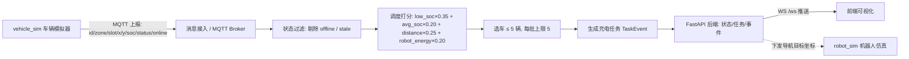
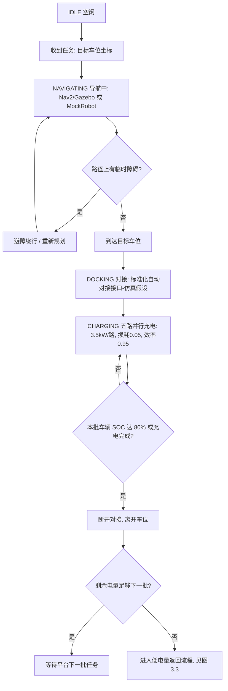
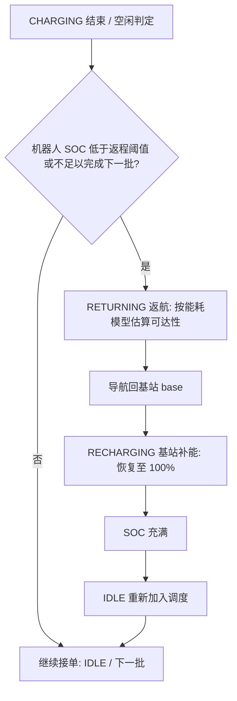

# 校园共享电动车移动集群充电仿真系统 — 项目范围说明（P0 冻结版）

> 角色：产品 / 系统负责人（对应方案中的 Kimi 角色）
> 文档状态：**P0 需求边界已冻结**，是后端 / 机器人 / 前端三条开发线共同的事实来源
> 任何超出本文档的改动须走评审，不得由单条开发线自行扩展

---

## 1. 项目定位

本项目是一个**基于物联网与自主导航的校园共享电动车移动集群充电仿真系统**。

- 性质：**课程项目的仿真系统，非真实部署**。
- 目标：在纯软件仿真环境中验证"移动充电机器人 + 集群调度"的完整业务闭环——车辆上报状态、平台打分选车、机器人导航对接、五路并行充电、低电量返基站补能。
- 交付：可运行的前端、后端、机器人仿真与实体桩，通过冻结的 `contracts/` 解耦，三轨并行开发、P5 汇合联调。

> 全系统的车辆、车位、电量、能耗、障碍、充电功率、时钟与事件均为**仿真数据**。对外呈现（API 响应、WS 推送、前端页面、日志、导出文件）必须显式携带 `simulation: true`（或中文"仿真"）标识，避免与真实业务混淆。

---

## 2. 冻结边界（逐条）

以下边界自 P0 起冻结，三条开发线不得越界：

1. **车辆不自动驾驶、不自动归位**：车辆位置与 SOC 由 `vehicle_sim/` 按配置生成并经 MQTT 上报；停车排布由**保安预排**（配置即事实来源）。系统不控制车辆行驶，也不要求车辆自动回位。
2. **每批最多 5 辆**：调度器单批次选车上限 `max_per_batch = 5`；充电通道恰为 5 路，一一对应。
3. **标准化自动对接接口（仿真假设）**：机器人与车辆之间的对接被抽象为**标准化自动对接接口**；仿真中以状态机 `DOCKING → CHARGING` 表达，假设接口天然可用，**不建模机械插拔失败**。
4. **真实自动插枪不在验收范围**：不实现、不验收任何真实机械臂插枪、插头识别、物理对准逻辑。
5. **真实车辆厂商接口不在验收范围**：不对接任何真实厂商 BMS / 云端 API；车辆数据全部来自本地仿真器。
6. **真实高功率充电不在验收范围**：单路功率固定为仿真参数 `3.5 kW`，传输损耗 `0.05`；不接入真实充电桩，不模拟高功率配电与安全保护。
7. **所有模拟数据必须明确标注"仿真"**：API、WS 事件、前端 UI、日志、导出文件均须带 `simulation: true` 或显式"仿真"字样；场景文件 `scenarios/campus_basic.yaml` 的 `meta` 中声明"全部为仿真数据"。
8. **仅 1 台机器人**：本场景只有机器人 `R01`，不含多机器人协同。

### 参数基线（与 contracts / 场景文件严格一致）

| 项 | 值 |
|---|---|
| 机器人储能 | 5.0 kWh，初始 SOC 100% |
| 移动能耗 | 0.05 kWh / 100 m |
| 充电效率 | 0.95 |
| 车辆规模 | 30 辆：A 区 12 / B 区 10 / C 区 8 |
| 车辆目标 SOC | 80% |
| 充电 | 5 路，每路 3.5 kW，传输损耗 0.05 |
| 调度权重 | low_soc 0.35 / avg_soc 0.20 / distance 0.25 / robot_energy 0.20 |
| 每批上限 | 5 辆 |
| 时钟源 | 后端（backend），倍速 1 / 10 / 60，ISO8601 UTC |

---

## 3. 三张流程图（Mermaid）

### 3.1 车辆上报与平台调度

### 3.2 机器人导航 - 对接 - 充电

### 3.3 机器人低电量返回基站

---

## 4. 角色与目录分工

| 角色（对应方案） | 负责目录 | 职责 | 不得修改 |
|---|---|---|---|
| 后端线（Codex / 通义灵码等） | `backend/`、`vehicle_sim/` | FastAPI 端点、调度打分、能源模型、MockRobot、MQTT 接入、WS 推送；车辆仿真数据生成 | `contracts/`、`frontend/`、`robot_sim/` |
| 机器人线 | `robot_sim/` | Nav2 / Gazebo 导航、对接状态机、避障、返基站；与后端约定接口 | `backend/`、`frontend/` |
| 前端线 | `frontend/` | WebSocket 订阅、车辆/机器人/任务/事件可视化、倍速与仿真标识展示 | `backend/`、`robot_sim/`、`vehicle_sim/` |
| 实体线 | `hardware/` | 实体桩 / 演示支撑件（仅课程展示），不参与验收闭环 | `backend/`、`robot_sim/` |
| 集成 / 事实来源 | `docs/`、`contracts/` | 本范围文档、接口契约、场景配置、任务卡、验收记录 | 业务代码目录 |

> `contracts/` 是唯一接口事实来源；三条开发线只依赖契约，不互相直接改代码。

---

## 5. 最终验收链路（全程无人工确认）

一次 `POST /api/simulation/start` 后，系统须自动完成以下闭环，中途**不需要任何人工点击或确认**：

1. **启动**：后端载入 `scenarios/campus_basic.yaml`，时钟源 backend，倍速 1 / 10 / 60。
2. **上报**：`vehicle_sim/` 经 MQTT 上报 30 辆（含 low / offline / stale）车辆状态；后端过滤 offline / stale。
3. **选 5 辆**：按冻结权重打分，每批选出最多 5 辆，生成任务。
4. **出发**：机器人 IDLE → 接收目标 → NAVIGATING。
5. **避障**：遇临时障碍自动绕行 / 重规划。
6. **对接**：到达车位 → DOCKING（标准化自动对接接口，仿真假设）。
7. **五路充电**：CHARGING，5 路 × 3.5 kW，损耗 0.05，效率 0.95，车辆充至目标 80%。
8. **离开**：本批完成 → 断开对接 → 离开车位。
9. **返基站或下一批**：电量足够则接下一批；不足则 RETURNING → 基站 RECHARGING → 100% → IDLE（不依赖人工）。

链路中每次状态变化均通过 `WS /ws` 推送，且与 `GET /api/robot`、`GET /api/vehicles`、`GET /api/tasks`、`GET /api/events` 保持一致；所有数据带 `simulation: true`。

---

## 6. 明确不新增的需求

本次 P0 **不再新增**以下内容，任何一条都需重新评审立项：

- 车辆自动驾驶 / 自动归位（车辆位置由保安预排 + 仿真上报决定）
- 真实自动插枪 / 机械臂插拔 / 插枪失败恢复
- 多机器人协同调度（本场景仅 1 台机器人 R01）
- 真实车辆厂商接口 / 真实 BMS / 真实充电桩
- 真实高功率充电与配电安全模拟
- 真实地图 / 真实路测 / 真实 GPS 依赖
